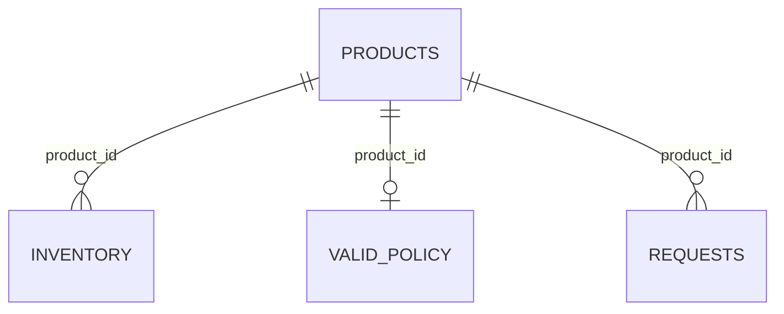
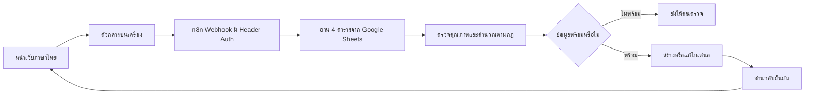

# BaanDee Stock Planner

ระบบต้นแบบช่วยพนักงานคลัง BKK-DC ตรวจสินค้าต่ำกว่าเกณฑ์และจัดทำใบเสนอเติมสินค้า พร้อมหลักฐานประกอบ ค่าที่ตรวจสอบไม่ได้จะส่งให้เจ้าหน้าที่ตรวจแทนการเดา

**กรณีตัวอย่าง:** SKU-0001 คงเหลือ 5 ชิ้น ขั้นต่ำ 15 เป้าหมาย 35 ระบบเสนอเติม 30 ชิ้น เจ้าหน้าที่สามารถบันทึก เปิดกลับมาแก้จำนวนพร้อมเหตุผล และส่งตรวจได้

## ปัญหา ผู้ใช้ และคุณค่า

- ผู้ใช้หลัก: พนักงานดูแลสต็อกในคลังเดียว
- ปัญหา: ต้องเปิดหลายตารางเพื่อเทียบสต็อกกับนโยบาย และติดตามข้อเสนอแยกจากกัน
- ระบบช่วยรวมหลักฐาน แสดงเหตุผล และเก็บใบเสนอที่เปิดกลับมาแก้ได้
- สมมติฐานคุณค่า: อาจลดเวลาและการตกหล่น ต้องทดลองกับผู้ใช้ก่อนอ้างผลประหยัดจริง
- ขอบเขต: เสนอเติมตามกฎ ไม่พยากรณ์ยอดขาย ไม่ออกใบสั่งซื้อจริง ไม่แก้ระบบองค์กร

## เริ่มใช้งานบนเครื่อง

ต้องมี Node.js 24 ขึ้นไป รุ่นที่ใช้ตรวจในงานนี้คือ 24.22.1 ตัวแอปและการทดสอบไม่ต้องติดตั้งแพ็กเกจเพิ่มเติม

1. ดาวน์โหลดหรือ clone repository แล้วเปิดโฟลเดอร์นี้
2. บน Windows ดับเบิลคลิก `START_LOCAL.bat` หรือเปิด terminal ในโฟลเดอร์แล้วรัน:

```sh
node src/server.mjs
```

3. เปิด http://127.0.0.1:8787
4. ใช้โหมดสาธิตย้อนหลัง 31 กรกฎาคม 2026 เวลา 09:00 น. ระบบแสดงชัดว่าไม่ใช่ข้อมูลสด
5. หยุดด้วย Ctrl+C ในหน้าต่างที่รันระบบ ข้อมูล SQLite ยังอยู่ใน `var/planner.sqlite`

อย่าเปิด `START_LOCAL.bat` และ `START_N8N.bat` พร้อมกันบนพอร์ตเดียวกัน

## ใช้ n8n + Google Sheets

เส้นทางหลักของโปรเจกต์คือ **หน้าเว็บ → n8n Webhook → Google Sheets → กฎตรวจข้อมูลและคำนวณ → บันทึก/อ่านกลับ → หน้าเว็บ** ตัวเว็บทำหน้าที่เป็นฟอร์มและตาราง ไม่ได้เรียกโมเดล AI

ดู [วิธีตั้งค่า n8n](docs/N8N_SETUP.md) แล้วรัน `START_N8N.bat` หรือ:

```sh
node --env-file=.env.local src/server.mjs
```

เมื่อเชื่อมถูกต้อง มุมบนจะแสดง **เชื่อมผ่าน n8n** หากบริการไม่พร้อม ระบบจะแจ้งว่าบันทึกยังไม่ยืนยัน และจะไม่เปลี่ยนไปบันทึกอีกฐานข้อมูลเงียบ ๆ

มีโหมดบนเครื่องเพื่อซ้อมและตรวจสำรอง โดยใช้กฎจากไฟล์เดียวกันและ SQLite แทน Sheets ข้อมูลใบเสนอของสองโหมดแยกกัน ไม่ซิงก์อัตโนมัติ

## แหล่งข้อมูลและความสัมพันธ์

| แหล่ง | บทบาท | จำนวนข้อมูลเริ่มต้น |
|---|---|---:|
| `data/raw/products.csv` | สินค้าจากอาจารย์ ไม่แก้ต้นฉบับ | 82 แถว |
| `data/raw/inventory_snapshot.csv` | สต็อกจากอาจารย์ ไม่แก้ต้นฉบับ | 82 แถว |
| `data/generated/replenishment_rules.csv` | แหล่งใหม่: นโยบายที่สร้างเพิ่ม | 83 แถว ก่อนตรวจ |
| ตาราง `requests` / SQLite | ข้อมูลใหม่ที่ผู้ใช้สร้างผ่านระบบ | เริ่มว่าง |



สินค้าเชื่อมด้วย `product_id` สต็อกใช้คู่ `product_id + location_id` และใบเสนอใช้ `request_id` เป็นรหัสถาวร นโยบายที่ซ้ำหรือกำกวมจะไม่เลือกแถวแรกมาใช้

รายละเอียดแหล่งที่มา วิธีสร้าง สมมติฐาน และ SHA-256 ของต้นฉบับอยู่ใน [DATA_GUIDE](docs/DATA_GUIDE.md) และ `data/source_manifest.json`

## กฎการเติมและการหยุด

- คงเหลือ **น้อยกว่า** ขั้นต่ำ: เสนอเติม = เป้าหมาย − คงเหลือ
- คงเหลือเท่ากับหรือมากกว่าขั้นต่ำ: ไม่เสนอเติม
- ข้อมูลสต็อกเก่ากว่า 24 ชั่วโมง อยู่ในอนาคต หรือไม่ผ่านตรวจ: หยุดให้คนตรวจ
- ไม่พบนโยบาย นโยบายซ้ำ ค่าไม่ครบ หรือยังไม่มีผล: หยุดให้คนตรวจ
- ระยะเวลารอสินค้าเป็นข้อมูลประกอบ ไม่ได้ใช้ทำนายวันหมดสต็อก
- แก้จำนวนจากคำแนะนำต้องใส่เหตุผล และใช้จำนวนเต็มบวก
- สถานะ: ร่าง → รอตรวจ → อนุมัติในต้นแบบ หรือยกเลิกพร้อมเหตุผล
- ใบเสนอที่อนุมัติ/ยกเลิกแล้วเปิดอ่านได้ แต่แก้ต่อไม่ได้
- หนึ่งสินค้าต่อคลังมีใบเสนอที่ยังไม่ยกเลิกได้หนึ่งรายการ รวมรายการอนุมัติ เพราะต้นแบบยังไม่มีขั้นรับสินค้าเข้าคลัง

ผลเริ่มต้นในโหมดสาธิต: สินค้า 82 รายการ, ควรเสนอเติม 28, เพียงพอ 49, รอตรวจ 5

## โครงสร้างและหน้าที่



| ส่วน | เหตุผลที่เลือก |
|---|---|
| n8n | เห็นการเชื่อมระบบและเส้นทางข้อมูล ตรวจ node ที่ส่ง/รับได้ |
| Google Sheets | ตรวจข้อมูลตัวอย่างและผลบันทึกร่วมกันได้ |
| JavaScript ตามกฎ | ตรวจสูตรและทดสอบซ้ำได้ ไม่ต้องใช้โมเดลสร้างตัวเลข |
| หน้าเว็บภาษาไทย | ผู้ใช้ค้นหา สร้าง เปิด และแก้ใบเสนอโดยไม่เข้า editor ของ n8n |
| SQLite ในโหมดเครื่อง | เก็บข้อมูลถาวร มี transaction, unique index และ audit สำหรับการซ้อม |

`src/core.mjs` เป็นเจ้าของกฎ `scripts/build_workflows.mjs` ฝังกฎไฟล์เดียวกันใน Code node เพื่อไม่ให้กฎระหว่างโหมดต่างกัน หลังแก้กฎต้องสร้าง workflow ใหม่และนำเข้าทดสอบใหม่

## ตรวจคุณภาพข้อมูลและทำซ้ำ

```sh
node scripts/generate_policies.mjs
node scripts/prepare_data.mjs
node scripts/run_tests.mjs
```

คำสั่งแรกสร้างข้อมูลสังเคราะห์ชุดเดิมซ้ำได้ ไม่ควรรันทับนโยบายที่ทีมแก้ใช้งานจริงโดยไม่เก็บสำเนา

- ผลสะอาด: สินค้า 82 สต็อก 82 นโยบาย 77 แถว
- บันทึกการปรับตามกฎ 10 รายการ และแยกให้คนตรวจ 6 แถว
- SKU-0007 ไม่มีนโยบายตั้งแต่ต้น จึงไม่ใช่หนึ่งใน 6 แถวที่ถูกแยก แต่ยังต้องขึ้นรอตรวจ
- มีปัญหาที่ต่างกัน เช่น หมวดหมู่ไม่ตรงมาตรฐาน รหัสมีช่องว่าง ค่าหาย ค่าไม่สมเหตุผล นโยบายซ้ำ และรหัสที่ไม่มีสินค้ารองรับ
- หลักฐานก่อน–หลังอยู่ใน `data/cleaned/quality_issues.csv` และ `quality_report.json`

## การทดสอบและการสาธิต

```sh
node scripts/run_tests.mjs
node scripts/integration_test.mjs
```

คำสั่ง integration เริ่มต้นเรียก data API บนเครื่องพอร์ต 8788 ต้องเปิดระบบก่อน หากตั้ง `N8N_WEBHOOK_URL` และ `N8N_AUTH_TOKEN` จะทดสอบเส้นทาง n8n แทน ใช้ข้อมูลทดสอบ SKU-0011 และยกเลิกใบเสนอเมื่อจบ หากรอบก่อนหยุดกลางทาง ให้เปิดใบเสนอเดิมตรวจและยกเลิกก่อนรันทดสอบใหม่

ดูผลที่บันทึกจริงใน `tests/results/` และสถานะตรวจล่าสุดใน [VERIFICATION](docs/VERIFICATION.md) แผนสาธิต 8 นาทีอยู่ใน [DEMO](docs/DEMO.md)

## ข้อจำกัดและความปลอดภัย

- ข้อมูลเป็นภาพย้อนหลัง ใช้โหมดเวลาจำลองอย่างเปิดเผย ไม่เปลี่ยนวันที่ต้นฉบับให้เหมือนข้อมูลสด
- เกณฑ์เติมและช่วงความสดใหม่เป็นสมมติฐานของโครงงาน ยังไม่ผ่านการรับรองจากธุรกิจจริง
- เส้นทาง Sheets เป็นต้นแบบ **ผู้ปฏิบัติงานหนึ่งคนในแต่ละครั้ง** การตรวจ revision และรายการซ้ำไม่ใช่ transaction ข้ามหลายคำขอพร้อมกัน ห้ามอ้างว่าป้องกันการแข่งขันของผู้ใช้หลายคนได้ครบ
- โหมด SQLite ใช้ transaction และ unique index ซึ่งต่างจากข้อจำกัดของ Sheets
- ผู้ใช้กรอกชื่อผู้ทำรายการเอง สถานะอนุมัติไม่ใช่ระบบสิทธิ์แยกผู้อนุมัติจริง
- ไม่มีการรับสินค้าเข้าสต็อก การส่งคำสั่งซื้อให้ผู้ขาย หรือการพยากรณ์
- n8n Cloud ต้องใช้อินเทอร์เน็ตและบัญชีที่ยังใช้งานได้
- เก็บ Header Auth เฉพาะเครื่องและ n8n credential ไม่ฝังในหน้าเว็บ ไม่ใส่ใน GitHub หรือ ZIP ที่แจก
- เปิดเว็บและ data API เฉพาะ loopback ไม่เปิด data API ออกอินเทอร์เน็ต
- ก่อน export จาก n8n ต้องลบ credential references, URL ส่วนตัว และ execution/pinned data ตามคู่มือ
- ข้อมูลอาจารย์ใช้เพื่อรายวิชา ไม่มีการให้สิทธิ์เผยแพร่ต่อทั่วไปใน repository นี้

## สมาชิกและการแบ่งงาน

รายชื่อที่ฟ่าให้มา:

| สมาชิก | รหัสนิสิต | หน้าที่รับผิดชอบ |
| นายอภิวัชร์ เรวกุลหิรัณย์ | 67011216009 | ดูแลข้อมูล กฎเติมสินค้า และการเชื่อม n8n กับ Google Sheets |
| นายปวรุต สุดสะอาด | 67011216012 | ดูแลหน้าจอ การสร้าง/แก้ใบเสนอ และการทดสอบระบบ |

ทีมมีสมาชิก 2 คน ให้ตรวจสอบกับอาจารย์ว่าจำนวนสมาชิกนี้ได้รับอนุโลมหรือไม่ เนื่องจากโจทย์ระบุทีม 3–4 คน งานทั้งสองส่วนต้องผ่านการตรวจและทดลองร่วมกันก่อนส่ง

อ่าน [AI_USE.md](AI_USE.md) เพื่อดูการใช้ AI ตามจริง ทีมต้องตรวจโค้ด ทดลอง และอธิบายงานก่อนส่ง ประวัติ commit ที่สร้างโดยผู้ช่วยไม่ใช่หลักฐานว่าทุกคนในทีมมีส่วนร่วม

## ส่งงาน

ส่ง URL repository ที่อาจารย์เข้าถึงได้ พร้อมสาธิตสด 8 นาที และตอบคำถาม 4 นาที ตั้ง tag หรือ release `v1.0-final` หลังตรวจไฟล์ส่งครบ ถ้า repository เป็น private ต้องเชิญบัญชีอาจารย์ก่อนส่ง URL

เอกสารทั้งหมดอยู่ใน repository ไม่ต้องทำรายงานแยกเพิ่มตามโจทย์ที่ให้มา
