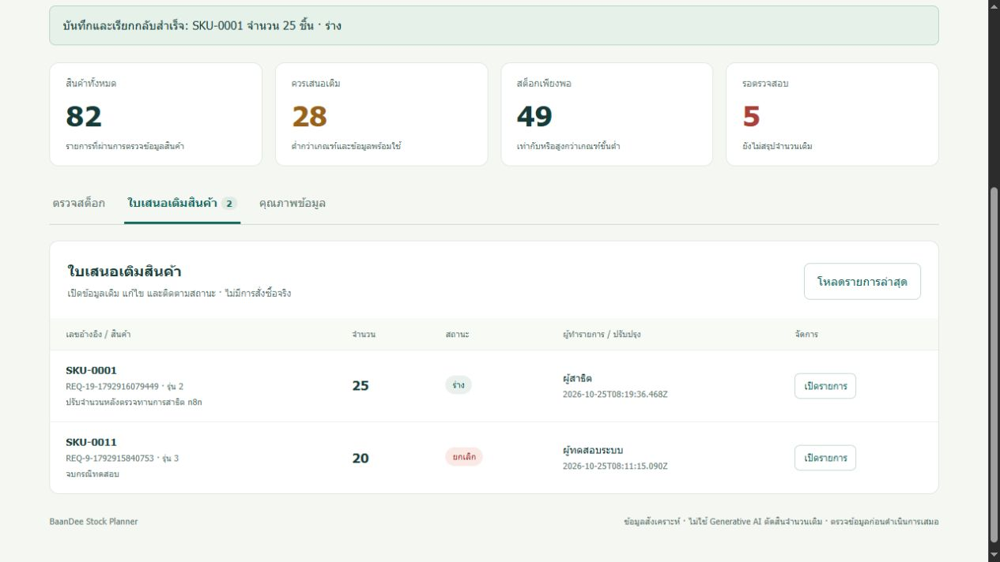

# ผลตรวจโปรเจกต์ BaanDee Stock Planner

ตรวจสถานะล่าสุดวันที่ 25 ตุลาคม 2026 ตามหลักฐานที่บันทึกไว้ในโปรเจกต์ ไม่ใช้การสร้างไฟล์สำเร็จแทนการทดสอบระบบจริง

ผลซ่อมการอ้างอิงชื่อ node ภาษาไทยและทดสอบระบบจริงรอบล่าสุดอยู่ใน [REPAIR_2026-10-25](REPAIR_2026-10-25.md): Production กลับมา HTTP 200, cloud integration 14/14 ผ่าน, unit tests 33/33 ผ่าน และกดสร้าง–แก้–ยกเลิกใบเสนอผ่านหน้าเว็บพร้อมตรวจ Google Sheets โดยตรงแล้ว

## ผลตรวจที่ทำได้

| เกณฑ์ | ผล | หลักฐาน |
|---|---|---|
| ใช้ข้อมูลต้นฉบับจากอาจารย์และข้อมูลที่ออกแบบเพิ่ม | ผ่าน | CSV ต้นฉบับ 2 ชุดมี SHA-256 ตรง manifest; เพิ่มกฎเติม 83 แถว และนำเข้าชีต `products`, `inventory`, `policies`, `requests` |
| พบและจัดการปัญหาคุณภาพข้อมูลอย่างน้อย 3 แบบ | ผ่าน | บันทึกค่าที่ normalize, ค่าขาด/ผิดช่วง, กฎซ้ำ และ SKU ที่จับคู่ไม่ได้ พร้อมกฎก่อน–หลังและแถว quarantine ใน `data/cleaned/` กับ `docs/DATA_GUIDE.md` |
| มีขอบเขตเชื่อมต่อระบบ | ผ่าน | เว็บเรียก n8n Cloud Webhook; workflow อ่านและเขียน Google Sheets; ทดสอบคำขอจริง 14 กรณี |
| ผู้ใช้สร้าง อ่าน และแก้ใบเสนอที่บันทึกไว้ได้ | ผ่าน | สร้าง SKU-0001 จำนวน 30 แล้วแก้เป็น 25; Google Sheets อ่านกลับเป็น revision 2 และหน้าเว็บโหลดข้อมูลล่าสุดตรงกัน |
| มีกรณีหยุด/ให้คนตรวจ | ผ่าน | SKU-0003–0007 ถูกส่งเข้าตรวจเพราะนโยบายไม่พร้อม; การทดสอบข้อมูลเก่าและคำขอผิดรูปแบบถูกปฏิเสธ |
| มีการทดสอบซ้ำพร้อม expected/actual | ผ่าน | Unit 33/33, n8n rule workflow 7/7, cloud integration 14/14; รายละเอียดอยู่ใน `tests/results/` |
| ไฟล์เริ่มใช้งาน เอกสาร และ workflow export | ผ่าน | มี README, `.env.example`, `AI_USE.md`, data guide, n8n setup, demo script, workflow JSON และ GitHub Actions ตรวจ SHA/data/unit tests |
| GitHub project และ automated checks | ผ่าน | repository เป็น public; ไฟล์อยู่บน branch `main`; GitHub Actions workflow `Verify prototype` ผ่าน |

## หลักฐานการทดสอบระบบ

- `tests/results/unit-tests.tap` — ผลทดสอบกฎและการคงข้อมูลใน SQLite เมื่อปิดแล้วเปิดใหม่
- `tests/results/n8n-rule-results.json` — ผล workflow ทดสอบกฎใน n8n จริง
- `tests/results/cloud-integration.csv` และ `.json` — input, expected, actual และผลลัพธ์ของ Google Sheets ผ่าน n8n Cloud รวมการปฏิเสธคำขอที่ไม่มีรหัส
- ภาพหน้าจอด้านล่างแสดงหน้ารายการหลังแก้ SKU-0001 และโหลดข้อมูลจาก n8n อีกครั้ง

## ต้องทำก่อนส่งอาจารย์

1. ทีมมี 2 คน ผู้ใช้ยืนยันวันที่ 26 ตุลาคม 2026 ว่าอาจารย์อนุญาตแล้ว
2. ผู้ใช้ยืนยันว่าสมาชิกทั้งสองทดลองตรวจสต็อก สร้าง แก้ ยกเลิก และตรวจ requests แล้ว บันทึกคำยืนยันใน AI_USE.md โดยแยกจากผลตรวจของผู้ช่วย
3. ส่งลิงก์ repository/release `v1.0.1` ซึ่งรวม workflow ภาษาไทยและหลักฐานหลังซ่อม
4. ทุกคนในทีมควรซ้อมเดโม 8 นาทีและ Q&A 4 นาทีตาม `docs/DEMO.md`; เสนอวันนำเสนอ 3 วันที่เข้ากับตารางเรียน/อาจารย์
5. ตรวจข้อกำหนดรายวิชาอีกครั้งก่อนส่ง เพราะการสาธิตสดและการแบ่งงานต้องทำโดยทีม

## ขอบเขตหลักฐาน

ข้อมูลต้นฉบับเป็น snapshot วันที่ 31 กรกฎาคม 2026 และเกณฑ์เติมเป็นข้อมูลสังเคราะห์เพื่อสาธิต ตัวเลขจากระบบจึงไม่ใช่สต็อกปัจจุบันหรือคำแนะนำสั่งซื้อจริง การทดสอบ Cloud ใช้ Google Sheets ที่แชร์สิทธิ์ผู้เขียนให้ `apiwatzexe312@gmail.com`; เจ้าของไฟล์ยังเป็นบัญชีมหาวิทยาลัย การบันทึก Google Sheets ไม่มี transaction สำหรับหลายผู้ใช้พร้อมกัน จึงยังจำกัดเป็นต้นแบบผู้ใช้งานทีละคน
